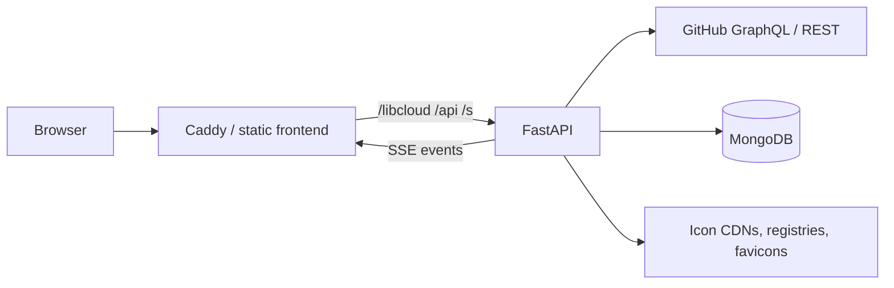

# LibCloud

Turn your GitHub dependency graph into a shareable logo cloud.

LibCloud scans repositories you own, extracts dependencies from manifests, normalizes package names, resolves logos, and renders an interactive SVG/PNG cloud sized by usage. It includes a React frontend, a FastAPI backend, and a read-only ops dashboard for scan history.

## Highlights

- **Manifest coverage**: GitHub dependency graph plus clone fallback for `package.json`, `pyproject.toml`, `requirements.txt`, `Pipfile`, `pom.xml`, Gradle, `go.mod`, `Cargo.toml`, `Gemfile`, Docker files, and GitHub Actions workflows.
- **Noise filtering**: Drops test runners, linters, type stubs, and low-level transport shims.
- **Normalization**: Groups aliases and SDKs (`boto3` → AWS SDK, `google-api-python-client` → Google, `axois` → Axios).
- **Icon resolution**: Cache → Devicon/SimpleIcons/Iconify → registry metadata → GitHub assets → website favicons → GitHub avatar.
- **Placeholder rejection**: Rejects the Sphinx/Read the Docs default "building" favicon and default GitHub identicons instead of caching them as real logos.
- **Presets**: Paper (default), Ink, Graph, Techy, and Space, with matching SVG/PNG export.
- **Sizes**: Web (1400×900), README card (920×540), and Social (1200×630).
- **Share snapshots**: Stores an SVG/PNG snapshot and generates a public page plus README Markdown.
- **Ops dashboard**: Protected run history with failure, unnormalized, filtered, and validation views plus CSV exports.

## Stack

| Layer | Technology |
| :--- | :--- |
| Backend | FastAPI, Uvicorn, httpx, BeautifulSoup, Motor |
| Frontend | React 19, Vite, D3, GSAP, Tailwind CSS, Zustand |
| Storage | MongoDB for icon/repo caches, run history, and shares; in-memory fallback |
| Sources | GitHub GraphQL/REST, Devicon, SimpleIcons, Iconify, package registries, site favicons |

## Quick start

### Prerequisites

- Python 3.12+
- [uv](https://docs.astral.sh/uv/)
- Node.js 22 LTS (Vite 8 requires Node 20.19+ or 22.12+)
- MongoDB 7+ (optional locally; the app falls back to memory)
- Docker + Docker Compose (optional)

### 1. Backend

```bash
git clone https://github.com/DineshThumma9/LibCloud.git
cd LibCloud/backend

cp .env.example .env
# Edit .env and set GITHUB_TOKEN. Set OPS_USER/OPS_PASSWORD to enable /ops.

uv sync
uv run uvicorn app.main:app --reload --host 0.0.0.0 --port 8000
```

The API is now at `http://localhost:8000`. Check `http://localhost:8000/health`.

> A GitHub token is strongly recommended. GitHub GraphQL requests are heavily rate-limited without one, and private repositories require a token with access.

### 2. Frontend

In a second terminal:

```bash
cd LibCloud/libcloud
npm ci
npm run dev
```

Open `http://localhost:5173`. Vite proxies `/libcloud`, `/api`, and `/s/` to the backend on port 8000.

### 3. Generate a cloud

1. Enter a GitHub username.
2. Optionally paste a GitHub PAT.
3. Click **Generate**.
4. Pick a preset, size, sort order, and logo limit.
5. Export SVG/PNG or create a share link/README snippet.

## Configuration

Copy `backend/.env.example` to `backend/.env`. Only `backend/.env` is loaded by the backend; do not create `backend/app/.env`.

| Variable | Default | Purpose |
| :--- | :--- | :--- |
| `GITHUB_TOKEN` | empty | GitHub PAT used by the CLI and as the server default for web scans. Strongly recommended. |
| `GITHUB_USERNAME` | empty | Default username for `scripts/pipeline_demo.py`; the web UI asks for the username. |
| `MONGO_URI` | built from `MONGO_HOST`/`MONGO_PORT` | MongoDB connection string. If unreachable, caches fall back to memory and shares/runs do not survive restarts. |
| `MONGO_DB_NAME` | `my_mongodb` | Database name. |
| `OPS_USER` / `OPS_PASSWORD` | empty | Enable the `/ops` dashboard. If either is empty, `/api/ops/*` returns `503`. |
| `FRONTEND_URL` | empty | Extra allowed CORS origin. Only needed for split frontend/backend origins. |
| `MAX_CONCURRENT_REPO_SCANS` | `5` | Parallel repository scans. |
| `MAX_CONCURRENT_ICON_RESOLVES` | `10` | Parallel icon lookups. |
| `REQUEST_TIMEOUT_SECONDS` | `10.0` | HTTP timeout for icon/registry requests. |
| `RUNS_DIR` | `backend/data/runs` | CLI artifact directory. |

The frontend uses relative paths, so the simplest production setup serves it from the same origin as the API. `FRONTEND_URL` only opens CORS; it does not rewrite API requests.

## Docker (backend + MongoDB)

The included `docker-compose.yml` runs the FastAPI backend and MongoDB. It does **not** build the frontend.

```bash
cp backend/.env.example backend/.env
# Edit backend/.env
docker compose --env-file backend/.env up --build
```

- Backend: `http://localhost:8000`
- MongoDB: `127.0.0.1:27017` (loopback only)
- Compose overrides `MONGO_URI` so the backend talks to the `db` service.
- `--env-file backend/.env` keeps the Compose interpolation and container credentials in sync.
- `backend/.env` is loaded via `env_file`; it is excluded from the Docker image by `backend/.dockerignore`.

For a production deployment, put Caddy or Nginx in front and keep ports 8000 and 27017 private. If you use MongoDB Atlas instead of the local `db` service, point `MONGO_URI` at Atlas and remove the `db` dependency/override.

## CLI pipeline

The CLI runs the full scan, resolves icons, writes SVGs, and exports audit CSVs:

```bash
cd backend
uv run python scripts/pipeline_demo.py
```

Artifacts are written to `backend/data/runs/<username>/<run_id>/`:

| File | Contents |
| :--- | :--- |
| `output.svg` | Web preset, 1400×900 |
| `output_readme.svg` | README card, 920×540 |
| `resolved.csv` | Resolved technologies, counts, methods, and source URLs |
| `resolution_metrics.csv` | Resolution method breakdown |
| `failed_icons.csv` | Packages with no icon |
| `validation_failures.csv` | Rejected image URLs and reasons |
| `filtered.csv` | Noise/unsupported manifest records |
| `unnormalized.csv` | Packages that could not be normalized |

Web runs do not write files. Their summaries and detail rows are stored in MongoDB (`runs`, `run_resolved`, `run_failures`, `run_unnormalized`, `run_filtered`, `run_validation`).

## API

| Method | Path | Description |
| :--- | :--- | :--- |
| `GET` / `POST` | `/libcloud?username=<user>` | Starts a scan and streams progress as Server-Sent Events (`text/event-stream`). |
| `POST` | `/api/shares` | Creates a share snapshot from `username`, `svg_data`, optional `png_base64`, and `title`. |
| `GET` | `/s/{share_id}` | Public share page. |
| `GET` | `/s/{share_id}/cloud.svg` | Shared SVG. |
| `GET` | `/s/{share_id}/cloud.png` | Shared PNG, when one was uploaded. |
| `GET` | `/health` | Health check. |
| `GET` | `/api/ops/summary` | Ops overview. |
| `GET` | `/api/ops/runs` | Run history (`username`, `limit`). |
| `GET` | `/api/ops/runs/{run_id}` | Run summary and detail rows. |
| `GET` | `/api/ops/details/{kind}` | Detail rows by kind (`resolved`, `failures`, `unnormalized`, `filtered`, `validation`). |
| `GET` | `/api/ops/search?q=` | Search run details. |
| `GET` | `/api/ops/runs/{run_id}/{kind}.csv` | CSV export. |

For `/libcloud`, pass the token as `Authorization: Bearer <token>`. The `token` query parameter is also accepted, but headers are safer because URLs can leak through logs and browser history.

SSE events include `job.accepted`, `repo.page`, `repo.listed`, `repo.scan.start`, `repo.scan.done`, `package.found`, `icon.resolved`, `icon.failed`, `done`, and `error`. Each event is a JSON envelope with `job_id`, `type`, `ts`, `seq`, and `data`.

## Architecture



Data flow: GitHub → dependency parser → normalization/noise filter → icon resolver → frequency-weighted cloud layout → SVG/PNG/share snapshot.

## Project layout

```text
backend/
  app/
    routes/          # /libcloud, shares, health, ops
    services/        # scanning, icon resolution, pipeline, rendering
    sources/         # icon libraries, registries, favicons, GitHub
    storage/         # MongoDB stores and in-memory fallbacks
  scripts/           # CLI pipeline demo
  tests/
libcloud/
  src/               # React app, presets, canvas, ops dashboard
docker-compose.yml   # backend + MongoDB
```

## Development

```bash
# Backend tests
cd backend
uv run pytest

# Frontend lint and production build
cd ../libcloud
npm run lint
npm run build
```

## Troubleshooting

| Symptom | Likely cause |
| :--- | :--- |
| GitHub `401`/`403` or scans return no repos | Missing/invalid token or rate limit. Set `GITHUB_TOKEN` or paste a PAT in the UI. |
| `503` from `/api/ops/*` | `OPS_USER` or `OPS_PASSWORD` is empty. |
| SSE disconnects or progress arrives in bursts | Reverse proxy buffering or a short read timeout. Disable buffering and raise the timeout. |
| Ops page 404s on reload | The static server is not falling back to `index.html` for `/ops/*`. |
| Icons missing | Check the ops failures view or `failed_icons.csv`. Default/placeholder favicons are rejected intentionally. |
| Data disappears after restart | MongoDB is unreachable, so the app used its in-memory fallback. Check `MONGO_URI` and networking. |
